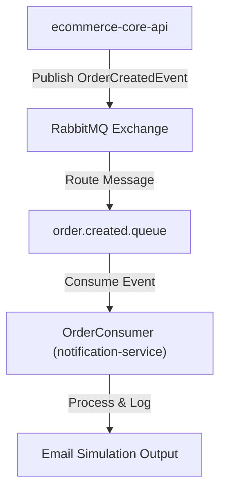
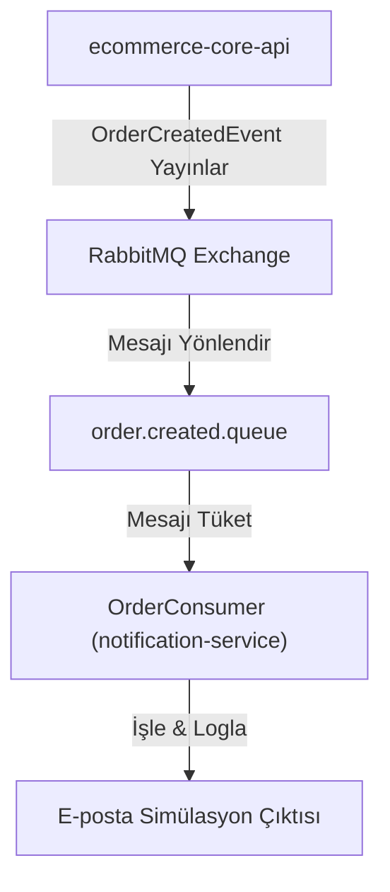

# 🔔 Notification Service

Decoupled event-driven notification microservice consuming real-time order events via RabbitMQ.

---

## 🌐 English

### 🚀 Overview
A lightweight microservice built with Spring Boot and Spring AMQP. It listens to `OrderCreatedEvent` messages published by `ecommerce-core-api` to RabbitMQ and executes simulated notification workflows (e.g., logging customer order confirmations and sending email notifications asynchronously).

### 🛠 Tech Stack
- **Language**: Java 21
- **Framework**: Spring Boot 3.x
- **Messaging**: Spring AMQP / RabbitMQ
- **Containerization**: Docker / Docker Compose
- **Build Tool**: Maven

### 📐 Architecture & Event Flow



### 💻 Getting Started (Installation)

#### Option 1: Run via Unified Docker Compose (Recommended)
This service is fully containerized and orchestrated alongside the core stack. From the main `ecommerce-core-api` directory:

```bash
docker compose up --build -d
```

View notification logs in real-time:
```bash
docker compose logs -f notification-service
```

#### Option 2: Run Standalone via Docker
```bash
docker build -t notification-service .
docker run --name notification-service --net host notification-service
```

#### Option 3: Run Locally via Maven
Ensure RabbitMQ is running locally on port `5672`:
```bash
./mvnw spring-boot:run
```

---

## 📍 Türkçe

### 🚀 Genel Bakış
Spring Boot ve Spring AMQP altyapısıyla geliştirilmiş, bağımsız bildirim mikroservisi. `ecommerce-core-api` tarafından RabbitMQ üzerine fırlatılan `OrderCreatedEvent` mesajlarını dinleyerek e-posta gönderim simülasyonunu ve bildirim süreçlerini eşzamansız (asynchronous) olarak yürütür.

### 🛠 Teknolojiler
- **Dil**: Java 21
- **Framework**: Spring Boot 3.x
- **Mesajlaşma**: Spring AMQP / RabbitMQ
- **Konteynerleştirme**: Docker / Docker Compose
- **Derleme Aracı**: Maven

### 📐 Mimari & Olay Akışı



### 💻 Kurulum Adımları

#### Yol 1: Docker Compose ile Çalıştırma (Önerilen)
`ecommerce-core-api` ana proje dizininden tüm mikroservis mimarisini başlatmak için:

```bash
docker compose up --build -d
```

Bildirim servisi loglarını canlı izlemek için:
```bash
docker compose logs -f notification-service
```

#### Yol 2: Tek Başına Docker ile Çalıştırma
```bash
docker build -t notification-service .
docker run --name notification-service --net host notification-service
```

#### Yol 3: Maven ile Lokal Çalıştırma
RabbitMQ'nun `5672` portunda çalıştığından emin olduktan sonra:
```bash
./mvnw spring-boot:run
```
