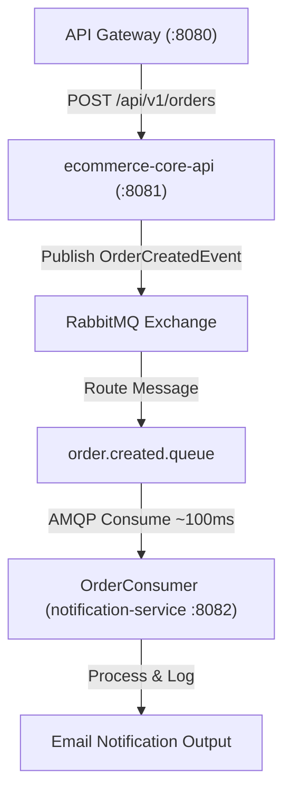
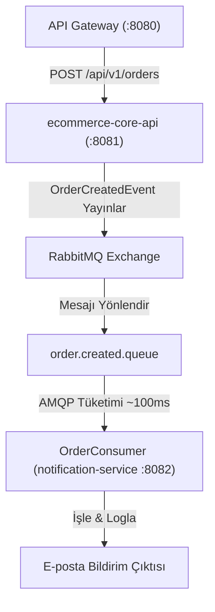

# 🔔 Notification Service

[](https://github.com/yusufkayiss/notification-service/actions/workflows/maven.yml)

Decoupled, event-driven notification microservice consuming real-time order events via **RabbitMQ** as part of the **E-Commerce Microservices Platform**.

---

## 🌐 English

### 🚀 Overview
A lightweight, asynchronous microservice built with **Java 21** and **Spring Boot 4.x** (Spring AMQP). It listens to `OrderCreatedEvent` messages published by [`ecommerce-core-api`](https://github.com/yusufkayiss/ecommerce-core-api) to RabbitMQ and executes customer notification workflows (order confirmation logging and simulated email dispatch) without blocking core checkout transactions.

### 🧩 Related Microservices

| Service | Repository | Port | Role |
| :--- | :--- | :---: | :--- |
| **API Gateway** | [`api-gateway`](https://github.com/yusufkayiss/api-gateway) | `8080` | Central entry point, JWT auth, rate limiting & routing |
| **Core API** | [`ecommerce-core-api`](https://github.com/yusufkayiss/ecommerce-core-api) | `8081` | Domain logic, inventory control & `OrderCreatedEvent` producer |
| **Notification Service** | [`notification-service`](https://github.com/yusufkayiss/notification-service) | `8082` | Asynchronous RabbitMQ consumer for order notifications |

### 🛠 Tech Stack
- **Language**: Java 21
- **Framework**: Spring Boot 4.x
- **Messaging**: Spring AMQP / RabbitMQ
- **Containerization**: Docker / Docker Compose
- **Build Tool**: Maven

### 📐 Architecture & Event Flow



### 💻 Getting Started (Installation)

#### Option 1: Run Full Platform via Docker Compose (Recommended)
All three repositories should be cloned into the same parent folder. From the `ecommerce-core-api` directory:

```bash
docker compose up --build -d
```

View notification logs in real-time:
```bash
docker compose logs -f notification-service
```

#### Option 2: Run Standalone via Docker
```bash
docker build -t notification-service .
docker run -p 8082:8081 --name notification-service notification-service
```

#### Option 3: Run Locally via Maven
Ensure RabbitMQ is running locally on port `5672`:
```bash
./mvnw spring-boot:run
```

---

## 📍 Türkçe

### 🚀 Genel Bakış
**Java 21** ve **Spring Boot 4.x** (Spring AMQP) altyapısıyla geliştirilmiş, olay güdümlü (event-driven) bildirim mikroservisi. [`ecommerce-core-api`](https://github.com/yusufkayiss/ecommerce-core-api) tarafından RabbitMQ üzerine yayınlanan `OrderCreatedEvent` mesajlarını dinleyerek sipariş onay loglarını ve e-posta bildirim simülasyonunu ana sipariş akışını yavaşlatmadan asenkron olarak yürütür.

### 🧩 İlgili Mikroservisler

| Servis | GitHub Deposu | Port | Görev |
| :--- | :--- | :---: | :--- |
| **API Gateway** | [`api-gateway`](https://github.com/yusufkayiss/api-gateway) | `8080` | Merkezi giriş noktası, JWT doğrulama, rate limiting ve yönlendirme |
| **Core API** | [`ecommerce-core-api`](https://github.com/yusufkayiss/ecommerce-core-api) | `8081` | İş kuralları, stok yönetimi ve `OrderCreatedEvent` üreticisi |
| **Notification Service** | [`notification-service`](https://github.com/yusufkayiss/notification-service) | `8082` | Sipariş bildirimleri için asenkron RabbitMQ tüketicisi |

### 🛠 Teknolojiler
- **Dil**: Java 21
- **Framework**: Spring Boot 4.x
- **Mesajlaşma**: Spring AMQP / RabbitMQ
- **Konteynerleştirme**: Docker / Docker Compose
- **Derleme Aracı**: Maven

### 📐 Mimari & Olay Akışı



### 💻 Kurulum Adımları

#### Yol 1: Docker Compose ile Tüm Platformu Çalıştırma (Önerilen)
Üç mikroservis deposu aynı ana klasör altında klonlanmış olmalıdır. `ecommerce-core-api` dizininden:

```bash
docker compose up --build -d
```

Bildirim servisi loglarını canlı izlemek için:
```bash
docker compose logs -f notification-service
```

#### Yol 2: Tek Başına Docker ile Çalıştırma
```bash
docker build -t notification-service .
docker run -p 8082:8081 --name notification-service notification-service
```

#### Yol 3: Maven ile Lokal Çalıştırma
RabbitMQ'nun `5672` portunda çalıştığından emin olduktan sonra:
```bash
./mvnw spring-boot:run
```
